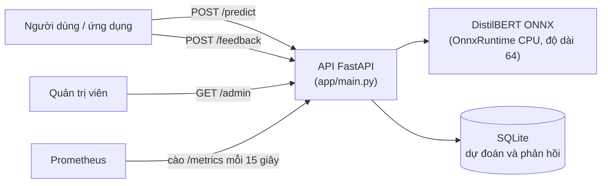
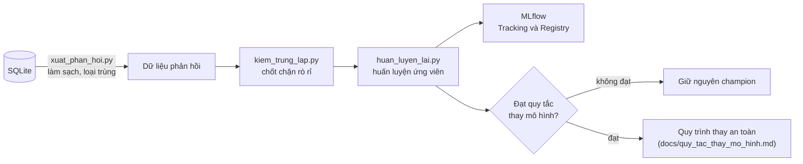

# Spam Filter MLOps

Hệ thống lọc tin nhắn rác (spam) kèm quy trình MLOps hoàn chỉnh: API phục vụ, trang quản trị, giám sát, kiểm thử tải, vòng phản hồi, theo dõi thí nghiệm và quản lý phiên bản mô hình.

Bài tập lớn môn **Phát triển các hệ thống thông minh** (INT14151), **Đề tài 12: Smart Anti-Spam & Malicious Content Filtering System**. Nhóm "Hộp Thư Sạch".

## Mục lục

1. [Tổng quan](#1-tổng-quan)
2. [Kiến trúc](#2-kiến-trúc)
3. [Cấu trúc thư mục](#3-cấu-trúc-thư-mục)
4. [Chạy bằng Docker Compose](#4-chạy-bằng-docker-compose)
5. [API](#5-api)
6. [Kiểm thử và CI](#6-kiểm-thử-và-ci)
7. [Giám sát với Prometheus](#7-giám-sát-với-prometheus)
8. [Kiểm thử tải với Locust](#8-kiểm-thử-tải-với-locust)
9. [Dữ liệu, mô hình và kết quả so sánh](#9-dữ-liệu-mô-hình-và-kết-quả-so-sánh)
10. [Tái tạo mô hình và thí nghiệm](#10-tái-tạo-mô-hình-và-thí-nghiệm)
11. [Vòng phản hồi và MLOps](#11-vòng-phản-hồi-và-mlops)
12. [Các tệp kết quả trong reports](#12-các-tệp-kết-quả-trong-reports)
13. [Quy ước làm việc](#13-quy-ước-làm-việc)
14. [Hạn chế](#14-hạn-chế)
15. [Thành viên](#15-thành-viên)
16. [Dữ liệu và trích dẫn](#16-dữ-liệu-và-trích-dẫn)

## 1. Tổng quan

**Mục tiêu:** phân loại tin nhắn thành spam hoặc ham (hợp lệ), phục vụ qua API, theo dõi chất lượng và vận hành, thu phản hồi người dùng để cải tiến mô hình một cách có kiểm soát.

**Phạm vi:** mô hình phân loại văn bản tin nhắn (bộ dữ liệu SMS tiếng Anh, bổ sung kiểm thử tiếng Việt). Hệ thống chưa có mô-đun riêng kiểm tra đường dẫn (URL) độc hại hay các loại nội dung độc hại ngoài spam.

**Đối chiếu yêu cầu đề bài:**

| Yêu cầu | Đáp ứng | Vị trí |
|---|---|---|
| API lọc spam | `POST /predict` nhận tin, trả nhãn dự đoán và xác suất, lưu vào SQLite | `app/main.py`, mục 5 |
| Web Admin xem thống kê | Trang `/admin` dùng `/stats` và `/recent` | `app/static/admin.html`, mục 5 |
| Vòng phản hồi MLOps | Thu phản hồi, làm sạch, huấn luyện lại, đánh giá theo quy tắc khai báo trước, MLflow | mục 11, `docs/quy_tac_thay_mo_hinh.md` |
| CLO1: so sánh 3 đến 4 mô hình | 5 mô hình, thống kê trung thực (khoảng tin cậy, McNemar) | mục 9, `reports/comparison_val.csv`, `reports/ket_qua_test.csv` |
| CLO2: kiến trúc, MLOps/DevOps | Docker Compose, CI, Prometheus, Locust, MLflow Tracking và Registry | mục 2, 4, 6, 7, 8, 11 |

## 2. Kiến trúc

**Luồng phục vụ và giám sát:**



**Vòng phản hồi MLOps:**



**Các điểm thiết kế chính:**

- API nạp mô hình ONNX (opset 17, độ dài cố định 64 token) bằng OnnxRuntime trên CPU; tokenizer dùng thư viện `tokenizers`. Đã kiểm tra tokenizer khớp với bản gốc bằng `src/kiem_tra_tokenizer.py`.
- Mỗi dự đoán được lưu vào SQLite bằng truy vấn có tham số (chống chèn mã SQL). Phản hồi của người dùng ghi vào cùng bản ghi.
- Số liệu Prometheus nằm trong bộ nhớ của API và đặt lại khi khởi động lại container. Số liệu thống kê `/stats` đọc từ SQLite nên được giữ lại.
- Container có kiểm tra sức khỏe (healthcheck). Mô hình gắn vào container ở chế độ chỉ đọc.
- Thư mục `models/` và `data/feedback/` không nằm trong Git (kích thước lớn, dữ liệu phản hồi cần bảo mật).

## 3. Cấu trúc thư mục

```
app/                  API FastAPI (main.py) và trang quản trị (static/admin.html)
src/                  Script dữ liệu, huấn luyện, đánh giá, vòng phản hồi, MLflow
tests/                Kiểm thử API (pytest, dùng mô hình giả)
loadtest/             Kịch bản Locust (locustfile.py)
monitoring/           Cấu hình Prometheus (prometheus.yml)
docs/                 Quy tắc thay mô hình và nhật ký quyết định
reports/              Kết quả đo (CSV, TXT, JSON, báo cáo tải HTML)
data/                 Dữ liệu (raw, processed, feedback, docker): không đưa lên Git
models/               Mô hình huấn luyện và ONNX: không đưa lên Git
.github/workflows/    CI (GitHub Actions)
Dockerfile, docker-compose.yml, requirements-*.txt
```

Các tệp `requirements-*.txt`: `api` (chạy API), `dev` (kiểm thử), `loadtest` (Locust), `mlflow` (theo dõi thí nghiệm).

## 4. Chạy bằng Docker Compose

**Yêu cầu:** Docker Desktop, và thư mục `models/` đã có mô hình ONNX cùng tokenizer (xem mục 10).

```powershell
docker compose up -d --build
docker compose ps
```

Sau khi khởi động, **đợi khoảng 30 giây** để mô hình nạp xong. Dùng `docker compose ps` đến khi trạng thái của `api` là `healthy`. Gọi API quá sớm có thể báo "connection closed unexpectedly".

| Dịch vụ | Địa chỉ | Ghi chú |
|---|---|---|
| API | http://127.0.0.1:8000 | Gắn `./models` chỉ đọc; dữ liệu SQLite ở `./data/docker` |
| Web Admin | http://127.0.0.1:8000/admin | Thống kê và các dự đoán gần đây |
| Prometheus | http://127.0.0.1:9090 | Cấu hình ở `monitoring/prometheus.yml`; kho số liệu là volume `prometheus_data` |

Xem nhật ký và dừng:

```powershell
docker compose logs api  # xem nhật ký của API
docker compose stop      # dừng, giữ container
docker compose down      # xóa container, giữ dữ liệu SQLite và kho Prometheus
docker compose down -v   # xóa cả kho Prometheus
```

Ảnh Docker của API: `spam-filter-api:latest`. Các dịch vụ có chính sách `restart: unless-stopped`.

## 5. API

| Phương thức | Đường dẫn | Mô tả |
|---|---|---|
| GET | `/health` | Kiểm tra tình trạng dịch vụ |
| POST | `/predict` | Dự đoán spam hoặc ham kèm xác suất, lưu bản ghi vào SQLite |
| POST | `/feedback` | Ghi nhãn đúng do người dùng gửi cho một dự đoán; trả 404 nếu không có bản ghi tương ứng; so sánh với nhãn mô hình để đếm đúng hoặc sai |
| GET | `/stats` | Thống kê tổng hợp từ SQLite (có các trường như `tong`, `so_phan_hoi`) |
| GET | `/recent` | Danh sách các bản ghi dự đoán gần đây |
| GET | `/admin` | Trang quản trị (HTML) |
| GET | `/metrics` | Số liệu theo định dạng Prometheus |

Cấu trúc yêu cầu và phản hồi (Pydantic) xem ở tài liệu tự sinh của FastAPI: http://127.0.0.1:8000/docs

Ví dụ gọi nhanh bằng PowerShell:

```powershell
Invoke-RestMethod http://127.0.0.1:8000/health
Invoke-RestMethod http://127.0.0.1:8000/stats
Invoke-RestMethod http://127.0.0.1:8000/recent
```

## 6. Kiểm thử và CI

```powershell
pip install -r requirements-api.txt -r requirements-dev.txt
pytest
```

- 17 bài kiểm thử trong `tests/test_api.py`, dùng **mô hình giả (stub)** nên không cần mô hình thật. Vì vậy chúng kiểm tra logic của API (đường dẫn, lưu SQLite, phản hồi, số liệu), không kiểm tra chất lượng mô hình.
- CI chạy `pytest` trên GitHub Actions (`.github/workflows/ci.yml`) mỗi lần đẩy mã. Các lần chạy gần đây đều xanh.

## 7. Giám sát với Prometheus

Prometheus cào `api:8000/metrics` mỗi 15 giây. Các chỉ số tự định nghĩa:

| Tên | Loại | Nhãn | Ý nghĩa |
|---|---|---|---|
| `spam_predictions_total` | Counter | `label` | Số dự đoán theo nhãn |
| `spam_feedback_total` | Counter | `ket_qua` | Số lần gửi phản hồi, theo đúng hoặc sai |
| `spam_http_requests_total` | Counter | `duong_dan`, `phuong_thuc`, `ma_trang_thai` | Số yêu cầu HTTP |
| `spam_inference_seconds` | Histogram | - | Thời gian suy luận trong hàm xử lý |
| `spam_http_request_seconds` | Histogram | `duong_dan` | Thời gian xử lý HTTP ở middleware |

Mở http://127.0.0.1:9090/targets để kiểm tra mục tiêu `api` đang `UP`. Ví dụ truy vấn (tab Graph):

```
sum by (label) (spam_predictions_total)
histogram_quantile(0.95, sum by (le) (rate(spam_inference_seconds_bucket[5m])))
```

Để tránh số lượng chuỗi thời gian tăng vô hạn (cardinality), nhãn `duong_dan` dùng mẫu đường dẫn đã định nghĩa; các đường dẫn lạ gom về giá trị `khac`.

**Giới hạn:** chưa có cảnh báo (alert) và Grafana. Bộ đếm `spam_feedback_total` đếm số lần gửi phản hồi, không đếm số tin khác nhau.

## 8. Kiểm thử tải với Locust

```powershell
pip install -r requirements-loadtest.txt
locust -f loadtest\locustfile.py --host http://127.0.0.1:8000 --headless -u 10 -r 2 -t 1m --csv reports\tai_10 --html reports\tai_10.html
locust -f loadtest\locustfile.py --host http://127.0.0.1:8000 --headless -u 50 -r 5 -t 1m --csv reports\tai_50 --html reports\tai_50.html
```

Tham số: `-u` là số người dùng đồng thời, `-r` là số người dùng thêm mỗi giây (tăng dần), `-t` là thời gian chạy. Mô hình tải là vòng kín: mỗi người dùng chờ phản hồi rồi mới gửi tiếp.

**Kết quả đã đo** (API trong Docker, Locust chạy cùng máy, mỗi mức 1 phút):

| Người dùng đồng thời | p95 phía máy khách (Locust) | Lỗi |
|---|---|---|
| 10 | 82 ms | 0 |
| 50 | 900 ms | 0 |

**Đọc kết quả:** thời gian đo ở ba tầng khác nhau. p95 suy luận trong hàm xử lý khoảng 197 ms, p95 HTTP ở middleware khoảng 785 ms, p95 phía máy khách (Locust) phụ thuộc mức tải. Chưa tách được nút thắt cổ chai: chênh lệch giữa các tầng gồm hàng đợi, ghi SQLite và tuần tự hóa. Đối chiếu hai nguồn: Locust ghi 2279 yêu cầu, Prometheus ghi 2287, chênh lệch nhỏ. p95 không ổn định theo thời gian ở mức 50 người dùng. Vì Locust và API chạy cùng một máy nên kết quả chỉ có tính tham khảo.

**Lưu ý:** các tệp CSV do Locust ghi theo chu kỳ nên có thể thiếu vài yêu cầu cuối; số liệu cuối lấy từ terminal và báo cáo HTML. Mở báo cáo HTML bằng cách bấm đúp vào tệp (mở qua Live Server sẽ hiện mã JavaScript thô).

## 9. Dữ liệu, mô hình và kết quả so sánh

**Dữ liệu:** bộ SMS Spam Collection (UCI), 5.574 tin gốc. Sau khi làm sạch và loại trùng còn 5.171 tin, chia theo tỷ lệ nhãn (stratified) 70/15/15 với hạt giống 42: **train 3.619, val 776, test 776**. Mỗi tập val và test có 98 tin spam (khoảng 12,6%). Loại trùng được thực hiện trước khi chia để tránh rò rỉ dữ liệu.

**Các mô hình so sánh** (lớp dương là spam):

| Mô hình | Ghi chú |
|---|---|
| TF-IDF + Logistic Regression | Mô hình cơ sở |
| TF-IDF + SVM tuyến tính | Mô hình nhẹ |
| TF-IDF + Random Forest | |
| Bi-GRU (từ điển riêng) | Mạng nơ-ron hồi quy hai chiều, tự xây từ điển |
| DistilBERT tinh chỉnh | `distilbert-base-uncased`, 3 epoch, batch 16, tốc độ học 2e-5, độ dài 64, AdamW (weight decay 0,01), hàm mất mát có trọng số theo tỷ lệ ham/spam, chọn epoch theo F1 trên val |

**Chỉ số:** precision, recall và F1 của lớp spam; số chặn nhầm (FP, ham bị đoán là spam) và số bỏ sót (FN, spam bị đoán là ham); khoảng tin cậy 95% của F1 bằng bootstrap; kiểm định McNemar giữa hai mô hình; phân tích ngưỡng.

**Kết quả chính** (số đầy đủ của cả 5 mô hình ở `reports/comparison_val.csv`):

| Chỉ số (lớp spam) | DistilBERT | SVM tuyến tính |
|---|---|---|
| F1 trên val | 0,959 | 0,938 |
| F1 trên test | 0,952 (khoảng tin cậy 95%: 0,920 đến 0,980) | 0,937 (0,899 đến 0,968) |

Kiểm định McNemar giữa hai mô hình trên test: p = 0,3438, **không có ý nghĩa thống kê**, tức chưa đủ bằng chứng nói DistilBERT tốt hơn SVM trên tập test này. Hai khoảng tin cậy chồng lên nhau.

**Phân tích lỗi** (`reports/loi_val.csv`, `reports/loi_chi_tiet.csv`, `reports/thi_nghiem_cai_tien.txt`):

- Thay đổi ngưỡng quyết định không giúp giảm các lỗi mà mô hình rất tự tin.
- Cắt chuỗi ở 64 token không phải nguyên nhân gây lỗi (0 trong 27 tin dài bị sai).
- Xác suất dự đoán đáng tin ở hai đầu (rất thấp hoặc rất cao).
- Spam có từ khóa người lớn có xu hướng bị bỏ sót (3 trên 15; Fisher p = 0,065, chưa có ý nghĩa thống kê).
- Không có cách kết hợp SVM với DistilBERT nào giảm được từ 3 lỗi trở lên, nên giữ DistilBERT đứng một mình.

## 10. Tái tạo mô hình và thí nghiệm

Phần huấn luyện cần PyTorch và Transformers (cài theo môi trường máy; nên có GPU). Chạy các script từ thư mục gốc dự án bằng PowerShell:

| Bước | Script | Vai trò |
|---|---|---|
| 1 | `src\download_data.py` | Tải bộ SMS Spam Collection (UCI) |
| 2 | `src\explore_data.py` | Khảo sát dữ liệu |
| 3 | `src\prepare_data.py` | Làm sạch, loại trùng, chia train/val/test 70/15/15 (hạt giống 42) |
| 4 | `src\baseline.py`, `src\compare_models.py` | TF-IDF + LogReg, SVM, Random Forest |
| 5 | `src\train_bigru.py`, `src\train_distilbert.py` | Bi-GRU và DistilBERT tinh chỉnh |
| 6 | `src\phan_tich_loi.py`, `src\phan_tich_loi_sau.py`, `src\thi_nghiem_cai_tien.py` | Phân tích lỗi và thí nghiệm cải tiến |
| 7 | `src\danh_gia_test.py` | Đánh giá trên test: khoảng tin cậy bootstrap, McNemar |
| 8 | `src\xuat_onnx.py`, `src\kiem_tra_tokenizer.py` | Xuất ONNX và kiểm tra tokenizer khớp |

Dữ liệu và mô hình được ghi vào `data/` và `models/` (không lên Git). Huấn luyện DistilBERT mất khoảng 3 phút trên GPU GTX 1650 Max-Q (đo ở bước huấn luyện lại).

## 11. Vòng phản hồi và MLOps

**Các bước:**

1. `src\xuat_phan_hoi.py`: đọc SQLite, chuẩn hóa văn bản, loại tin có nhãn xung đột, loại trùng, loại tin trùng với train/val/test. Ghi `data/feedback/phan_hoi_sach.csv` (không lên Git) và bản tóm tắt chỉ gồm số đếm.
2. `src\gui_phan_hoi_nhom.py`: gửi bộ tin kiểm thử của nhóm qua API để đo mốc trước huấn luyện lại. Cần tối thiểu 30 tin, chỉ chạy một lần, có chế độ `kiem-tra` để kiểm tra dữ liệu mà không gửi.
3. `src\kiem_trung_lap.py`: chốt chặn rò rỉ, đo độ giống (cosine trên n-gram ký tự, bỏ dấu) giữa tin train tiếng Việt và bộ đo cố định. Ngưỡng 0,5 do nhóm chọn thủ công; chỉ bắt được giống về mặt chữ.
4. `src\huan_luyen_lai.py`: huấn luyện ứng viên với đúng siêu tham số của mô hình hiện tại (chỉ khác dữ liệu), đo một lần trên UCI test và bộ đo cố định, ghi trực tiếp vào MLflow, lưu ở `models/distilbert_vi`.
5. MLflow:

```powershell
pip install -r requirements-mlflow.txt
mlflow server --host 127.0.0.1 --port 5000 --backend-store-uri sqlite:///mlflow.db
python src\ghi_mlflow_ket_qua.py     # nhập 7 run so sánh mô hình từ CSV (đánh dấu nhap_tu_csv)
python src\ghi_registry.py           # đăng ký champion và challenger trong Model Registry
```

6. Quy tắc thay mô hình và nhật ký quyết định: [docs/quy_tac_thay_mo_hinh.md](docs/quy_tac_thay_mo_hinh.md). Quy tắc được khai báo trước khi chạy và không sửa sau khi thấy kết quả.

**Thí nghiệm lệch miền (tiếng Việt):** giả thuyết khai báo trước khi đo: mô hình huấn luyện trên tiếng Anh sẽ kém hơn trên tin tiếng Việt. Bộ đo cố định gồm 50 tin (25 tiếng Việt, 25 tiếng Anh; 22 spam, 28 ham; do trợ lý AI soạn, nhóm rà soát).

| | Mô hình hiện tại | Ứng viên (thêm 90 tin tiếng Việt) |
|---|---|---|
| Spam tiếng Việt bắt được | 0/11 | 11/11 |
| Spam tiếng Anh bắt được | 10/11 | 11/11 |
| Ham bị chặn nhầm (FP) | 2 | 9 |
| F1 spam trên bộ đo | 0,588 | 0,83 |
| F1 spam trên UCI test | 0,952 | 0,945 |

- Mô hình hiện tại bỏ sót toàn bộ spam tiếng Việt: chênh lệch 0/11 so với 10/11 có Fisher p = 3,4×10⁻⁵. Hiện tượng được ủng hộ mạnh, còn nguyên nhân thì chưa được kiểm chứng.
- Ứng viên bắt được spam tiếng Việt nhưng chặn nhầm thêm tin hợp lệ (FP từ 2 lên 9, vượt giới hạn tối đa 4 của điều kiện c), nên **bị từ chối theo quy tắc khai báo trước**. Mô hình đang chạy giữ nguyên. Ứng viên được lưu làm `challenger` trong Model Registry (`champion` là mô hình đang chạy).
- Dù F1 tổng thể trên bộ đo của ứng viên cao hơn, quy tắc ưu tiên hạn chế chặn nhầm vì chặn nhầm tin hợp lệ (mã OTP, thông báo ngân hàng) tốn kém hơn bỏ sót.

## 12. Các tệp kết quả trong reports

| Tệp | Nội dung |
|---|---|
| `baseline_val.txt` | Kết quả mô hình cơ sở trên val |
| `comparison_val.csv` | So sánh 5 mô hình trên val |
| `ket_qua_test.csv` | Kết quả trên test kèm khoảng tin cậy bootstrap |
| `loi_val.csv`, `loi_chi_tiet.csv` | Các tin bị phân loại sai trên bộ UCI công khai |
| `thi_nghiem_cai_tien.txt` | Các thí nghiệm A đến D của phần phân tích lỗi |
| `tai_10*`, `tai_50*` (CSV, HTML) | Kết quả Locust ở 10 và 50 người dùng |
| `phan_hoi_tom_tat.txt` | Số đếm của bước xuất phản hồi (không chứa nội dung tin) |
| `phan_hoi_nhom_tom_tat.txt` | Số đếm của bước gửi tin kiểm thử (không chứa nội dung tin) |
| `kiem_trung_lap_tom_tat.txt` | Số đếm của chốt chặn rò rỉ |
| `ket_qua_huan_luyen_lai.json` | Kết quả cuối của ứng viên và đối chiếu quy tắc |

## 13. Quy ước làm việc

- Mã nguồn, tên tệp và thông điệp commit viết **không dấu** để tránh lỗi bảng mã; tài liệu như README viết có dấu.
- Dữ liệu phản hồi, tin kiểm thử và mô hình không đưa lên Git (xem `.gitignore`); chỉ đưa lên các tệp tóm tắt chứa số đếm.
- Mỗi bước được commit riêng, đẩy lên GitHub sau khi kiểm tra.
- Các số liệu trong tài liệu này đều lấy từ lần chạy thực tế của nhóm, không dùng số minh họa.

## 14. Hạn chế

- Val và test chỉ có khoảng 98 tin spam mỗi tập nên khoảng tin cậy rộng và mỗi tin sai ảnh hưởng lớn.
- Bộ đo 50 tin và bộ huấn luyện tiếng Việt bổ sung do trợ lý AI soạn, có thể cùng thiên lệch; bộ đo chỉ có 22 spam và 28 ham.
- Ứng viên chỉ chạy một cấu hình và một hạt giống, chưa biết mức dao động giữa các lần huấn luyện. Nguyên nhân FP tăng chưa được kiểm chứng (giả thuyết: dữ liệu bổ sung có tỷ lệ spam 40%, cao hơn UCI khoảng 13%).
- Chốt chặn rò rỉ chỉ bắt được giống về mặt chữ, không bắt được giống về ý.
- Kiểm thử `pytest` dùng mô hình giả nên không đo chất lượng mô hình.
- Kiểm thử tải chạy cùng máy với API, chưa tách được nút thắt cổ chai; chưa có cảnh báo và Grafana.
- Model Registry chỉ lưu thư mục mô hình để quản lý phiên bản, chưa nối tự động với API (API nạp ONNX từ ổ đĩa).
- Chưa có mô-đun kiểm tra URL độc hại hay nội dung độc hại ngoài spam.

## 15. Thành viên

Nguyễn Thành Đô (nhóm trưởng), Nguyễn Thị Hồng Thắm, Vũ Văn Hùng, Trần Thế Linh.

## 16. Dữ liệu và trích dẫn

SMS Spam Collection (CC BY 4.0):
Almeida, T. & Hidalgo, J. (2011). SMS Spam Collection [Dataset]. UCI Machine Learning Repository. https://doi.org/10.24432/C5CC84